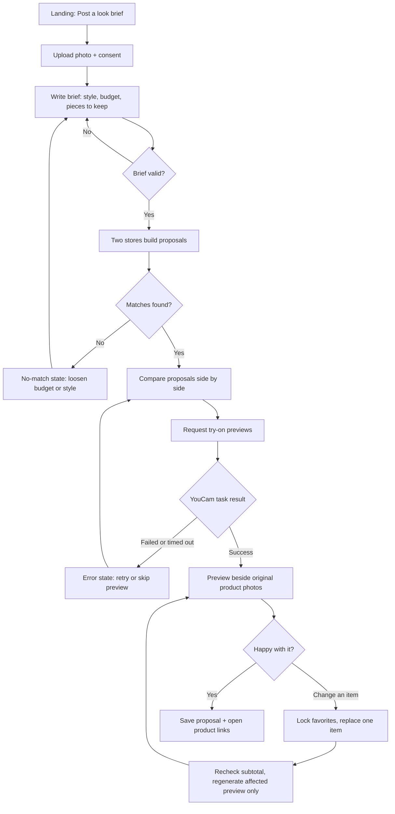
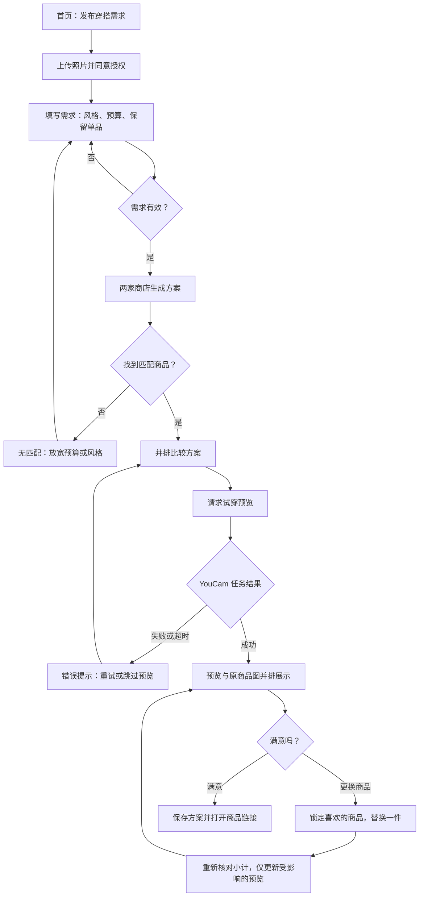

# Look Exchange — User Flow / 用户流程

[English](#english) · [简体中文](#简体中文)

Companion to the [Look Exchange potential PRD](look-exchange-potential-prd.md). Concept images are in [`concepts/`](concepts/).

配合 [Look Exchange 候选 PRD](look-exchange-potential-prd.md) 阅读。概念图见 [`concepts/`](concepts/)。

## English

**Status:** Proposed flow for the first prototype; not implemented.

**Version:** 0.1 · October 30, 2026

### Flow at a glance

### Steps

**1. Landing — post a look brief**
- The shopper sees one main action: **Post a look brief**.
- A short explainer says what happens: stores compete with try-on proposals; sample catalogs are labeled; no purchase happens in the prototype.

**2. Upload photo and consent**
- Upload a photo the shopper has the right to use. Show a preview, check format and size, and explain errors in plain language.
- Before anything is sent, a consent notice explains that the photo goes to YouCam for processing and how long it is kept.

**3. Write the brief**
- Free-text brief, for example: “Silver-and-black concert look, under $120. Keep my boots.”
- Structured fields beside it: budget, occasion, style words, and owned pieces to keep.
- The backend turns the brief into structured data. If a required part is missing or unclear (no budget, impossible budget), the shopper is asked to fix it before stores search.

**4. Stores build proposals**
- Two clearly labeled sample stores each assemble one proposal from their own catalog.
- A progress state shows each store “building a proposal.”
- If a store finds no valid match, it says so. The app never invents a product.

**5. Compare proposals**
- Proposals appear side by side. Each card shows: store name, item photos, item prices, subtotal (shipping and tax excluded unless known), source links, and a short styling rationale.
- Owned pieces the shopper asked to keep are shown as “kept,” not as products for sale.

**6. Request try-on previews**
- The shopper taps **Preview on me** for a proposal.
- Clothing (top or jacket) uses YouCam Clothes V4; a bag uses YouCam Bag try-on. Each category shows in its own panel at first.
- A status indicator shows the running task. Polling stops at a time limit and shows a clear failure with **Retry** or **Skip preview**.

**7. Review the preview**
- Each generated preview sits beside the original product photo so the shopper can judge both.
- Previews are labeled as AI-generated and do not promise size, fit, or exact product appearance.

**8. Revise: lock and replace**
- The shopper locks items they like and asks to replace one, for example “cheaper jacket” or “more silver.”
- The store retrieves an alternative, the subtotal is rechecked, and only the changed item's preview is regenerated. Locked items and their previews stay.
- Revision history lets the shopper return to an earlier version.

**9. Save and shop**
- The shopper saves the preferred proposal and opens product links.
- Sample inventory stays labeled. The prototype does not process payments.

### States every screen must handle

| State | What the shopper sees |
| --- | --- |
| Unsupported or oversized photo | What is wrong and how to fix it |
| Brief incomplete | Which field needs attention |
| No matching products | The store says it found none; suggests loosening budget or style |
| Over budget after a swap | Subtotal flagged; ask for another replacement |
| YouCam task failed or timed out | Retry or skip the preview; proposal still usable |
| Preview outdated after a change | Old preview hidden or marked out of date |

---

## 简体中文

**状态：** 首个原型的拟定流程，尚未实现。

**版本：** 0.1 · 2026 年 10 月 30 日

### 流程总览

### 步骤

**1. 首页 — 发布穿搭需求**
- 页面只有一个主要操作：**发布穿搭需求**。
- 简短说明流程：商店用试穿方案竞争；示例目录有明确标注；原型不进行购买。

**2. 上传照片并同意授权**
- 上传用户有权使用的照片。显示预览，检查格式和大小，用通俗语言说明错误。
- 发送前显示授权说明：照片将交由 YouCam 处理，以及保留时长。

**3. 填写需求**
- 自由文本需求，例如：“银黑色演唱会造型，预算 120 美元以内，保留我自己的靴子。”
- 旁边提供结构化字段：预算、场合、风格关键词、要保留的自有单品。
- 后端将需求转为结构化数据。若缺少必要信息或信息不明确（没有预算、预算不可行），先请用户修改，再开始检索。

**4. 商店生成方案**
- 两家明确标注的示例商店，各自从自己的目录组装一个方案。
- 进度状态显示每家商店“正在生成方案”。
- 若商店找不到有效商品，会直接说明，系统绝不编造商品。

**5. 比较方案**
- 方案并排展示。每张卡片包含：商店名称、商品图、单价、小计（未知的运费和税费不计入）、来源链接和简短搭配理由。
- 用户要求保留的自有单品显示为“保留”，不作为待售商品。

**6. 请求试穿预览**
- 用户点击某个方案的 **在我身上预览**。
- 服装（上衣或外套）使用 YouCam Clothes V4；包袋使用 YouCam Bag 试穿。初期每个品类单独展示。
- 状态指示显示任务进度。轮询有时间上限，超时后明确提示失败，并提供 **重试** 或 **跳过预览**。

**7. 查看预览**
- 每张生成预览都与原商品图并排，方便用户同时判断。
- 预览标注为 AI 生成，不保证尺码、合身程度或商品的精确外观。

**8. 修改：锁定与替换**
- 用户锁定喜欢的商品，并要求替换另一件，例如“便宜一点的外套”或“更多银色”。
- 商店检索替代品，重新核对小计，仅重新生成被替换商品的预览。已锁定的商品及其预览保持不变。
- 修改历史允许用户回到之前的版本。

**9. 保存并购物**
- 用户保存最喜欢的方案并打开商品链接。
- 示例库存始终有标注。原型不处理支付。

### 每个页面都需处理的状态

| 状态 | 用户看到的内容 |
| --- | --- |
| 照片格式不支持或过大 | 说明问题及解决方法 |
| 需求不完整 | 指出需要填写的字段 |
| 无匹配商品 | 商店说明未找到，建议放宽预算或风格 |
| 替换后超出预算 | 标出小计，请用户再换一件 |
| YouCam 任务失败或超时 | 可重试或跳过预览；方案仍可使用 |
| 修改后预览过期 | 隐藏旧预览或标记为已过期 |
