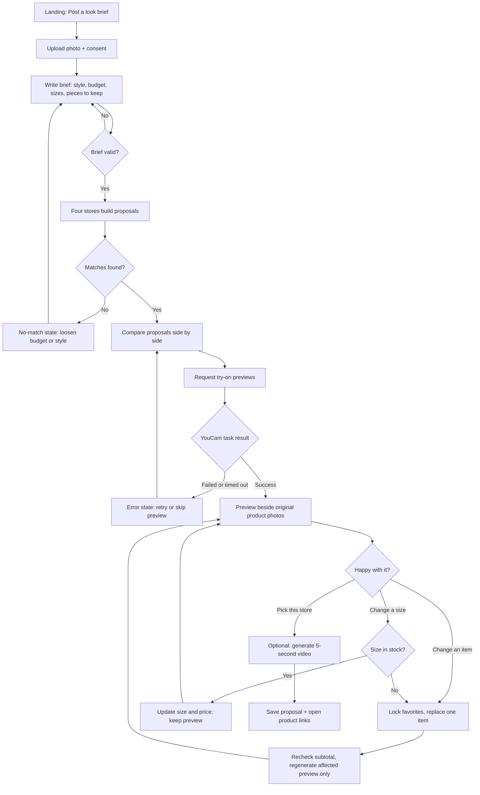
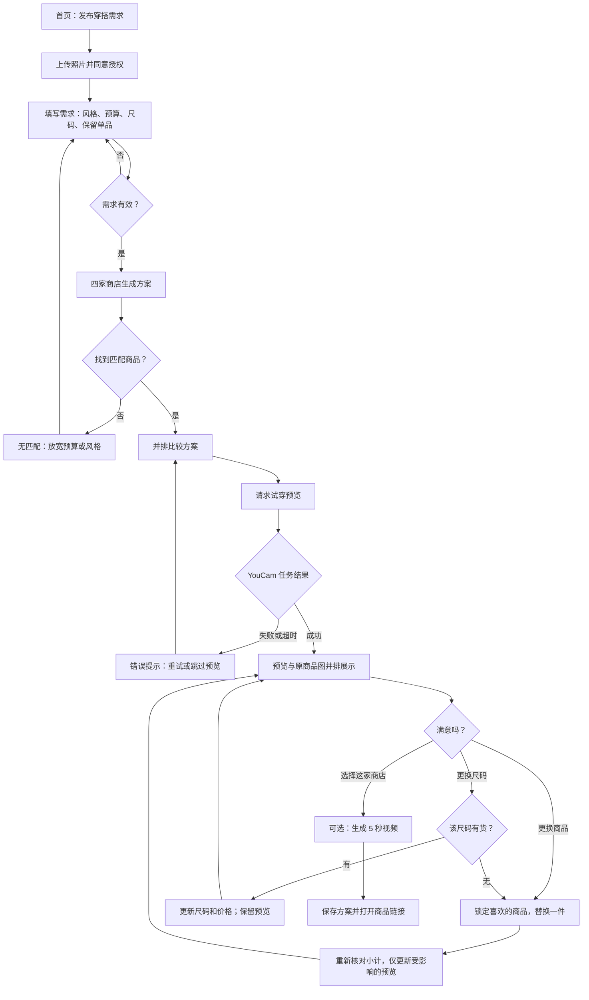

# Look Exchange — User Flow / 用户流程

[English](#english) · [简体中文](#简体中文)

Companion to the [Look Exchange PRD](look-exchange-prd.md). Concept images are in [`concepts/`](concepts/).

配合 [Look Exchange PRD](look-exchange-prd.md) 阅读。概念图见 [`concepts/`](concepts/)。

## English

**Status:** Proposed flow for the first prototype; not implemented.

**Version:** 0.3 · October 30, 2026 — adds shopper-chosen sizes and video generation

### Flow at a glance

### Steps

**1. Landing — post a look brief**
- The shopper sees one main action: **Post a look brief**.
- A short explainer says what happens: stores compete with try-on proposals; no purchase happens in the prototype.

**2. Upload photo and consent**
- Upload a photo the shopper has the right to use. Show a preview, check format and size, and explain errors in plain language.
- Before anything is sent, a consent notice explains that the photo goes to YouCam for processing and how long it is kept.

**3. Write the brief**
- Free-text brief, for example: “Silver-and-black concert look, under $120. Keep my boots.”
- Structured fields beside it: budget, occasion, style words, sizes, and owned pieces to keep.
- **Sizes:** the shopper picks their usual size for each category they want proposed: tops/jackets (XS–XXL) and, if relevant, bottoms (waist or XS–XXL). Bags need no size. Sizes are required before stores search.
- The backend turns the brief into structured data. If a required part is missing or unclear (no budget, impossible budget, no size), the shopper is asked to fix it before stores search.

**4. Stores build proposals**
- Four sample stores each assemble one proposal from their own catalog. The app shows them like real stores; the README explains they are samples.
- Stores only propose items available in the shopper's chosen size. Availability is checked in code against the catalog, not left to the language model.
- A progress state shows each store “building a proposal.”
- If a store finds no valid match, it says so. The app never invents a product.

**5. Compare proposals**
- Proposals appear side by side. Each card shows: store name, item photos, the selected size for each item, item prices, subtotal (shipping and tax excluded unless known), source links, and a short styling rationale.
- If a store lists a size chart, a **Size chart** link opens it beside the item.
- Owned pieces the shopper asked to keep are shown as “kept,” not as products for sale.

**6. Request try-on previews**
- The shopper taps **Preview on me** for a proposal.
- Clothing (top or jacket) uses YouCam Clothes V4; a bag uses YouCam Bag try-on. Each category shows in its own panel at first.
- A status indicator shows the running task. Polling stops at a time limit and shows a clear failure with **Retry** or **Skip preview**.

**7. Review the preview**
- Each generated preview sits beside the original product photo so the shopper can judge both.
- Previews are labeled as AI-generated and do not promise size, fit, or exact product appearance. The chosen size controls what is ordered, not how the preview looks.

**8. Revise: lock and replace**
- The shopper locks items they like and asks to replace one, for example “cheaper jacket” or “more silver.”
- The store retrieves an alternative, the subtotal is rechecked, and only the changed item's preview is regenerated. Locked items and their previews stay.
- **Change a size:** each item has a size picker. If the new size is in stock, the size and price update and the preview stays (size does not change the preview). If it is out of stock, the store offers a replacement item in that size.
- Revision history lets the shopper return to an earlier version.

**9. Pick a store and generate a video**
- The shopper taps **Pick this store** on the proposal they like best.
- A **Generate video** option appears on the picked proposal only. It turns the try-on preview into a 5-second video with YouCam's AI Video Generator (image-to-video).
- A progress state shows while the video renders (about a minute). Failure shows **Try again**; the proposal stays usable without a video.
- The video is labeled AI-generated and does not promise exact garment detail.

**10. Save and shop**
- The shopper saves the preferred proposal, with each item's size and the video if made, and opens product links.
- The prototype does not process payments.

### States every screen must handle

| State | What the shopper sees |
| --- | --- |
| Unsupported or oversized photo | What is wrong and how to fix it |
| Brief incomplete | Which field needs attention |
| No matching products | The store says it found none; suggests loosening budget or style |
| Over budget after a swap | Subtotal flagged; ask for another replacement |
| Size out of stock | Item marked unavailable in that size; replacement offered |
| Video failed or timed out | Try again; saving still works without a video |
| YouCam task failed or timed out | Retry or skip the preview; proposal still usable |
| Preview outdated after a change | Old preview hidden or marked out of date |

---

## 简体中文

**状态：** 首个原型的拟定流程，尚未实现。

**版本：** 0.3 · 2026 年 10 月 30 日 — 新增用户自选尺码和视频生成

### 流程总览

### 步骤

**1. 首页 — 发布穿搭需求**
- 页面只有一个主要操作：**发布穿搭需求**。
- 简短说明流程：商店用试穿方案竞争；原型不进行购买。

**2. 上传照片并同意授权**
- 上传用户有权使用的照片。显示预览，检查格式和大小，用通俗语言说明错误。
- 发送前显示授权说明：照片将交由 YouCam 处理，以及保留时长。

**3. 填写需求**
- 自由文本需求，例如：“银黑色演唱会造型，预算 120 美元以内，保留我自己的靴子。”
- 旁边提供结构化字段：预算、场合、风格关键词、尺码、要保留的自有单品。
- **尺码：** 用户为需要推荐的每个品类选择常穿尺码：上衣/外套（XS–XXL），如需下装则选择腰围或 XS–XXL。包袋无需尺码。开始检索前必须填写尺码。
- 后端将需求转为结构化数据。若缺少必要信息或信息不明确（没有预算、预算不可行、没有尺码），先请用户修改，再开始检索。

**4. 商店生成方案**
- 四家示例商店各自从自己的目录组装一个方案。应用中按真实商店样式展示；README 中说明它们是示例。
- 商店只推荐用户所选尺码有货的商品。库存由代码根据目录核对，不交给语言模型判断。
- 进度状态显示每家商店“正在生成方案”。
- 若商店找不到有效商品，会直接说明，系统绝不编造商品。

**5. 比较方案**
- 方案并排展示。每张卡片包含：商店名称、商品图、每件商品的已选尺码、单价、小计（未知的运费和税费不计入）、来源链接和简短搭配理由。
- 若商店提供尺码表，可点击 **尺码表** 在商品旁查看。
- 用户要求保留的自有单品显示为“保留”，不作为待售商品。

**6. 请求试穿预览**
- 用户点击某个方案的 **在我身上预览**。
- 服装（上衣或外套）使用 YouCam Clothes V4；包袋使用 YouCam Bag 试穿。初期每个品类单独展示。
- 状态指示显示任务进度。轮询有时间上限，超时后明确提示失败，并提供 **重试** 或 **跳过预览**。

**7. 查看预览**
- 每张生成预览都与原商品图并排，方便用户同时判断。
- 预览标注为 AI 生成，不保证尺码、合身程度或商品的精确外观。所选尺码决定购买的商品规格，不影响预览效果。

**8. 修改：锁定与替换**
- 用户锁定喜欢的商品，并要求替换另一件，例如“便宜一点的外套”或“更多银色”。
- 商店检索替代品，重新核对小计，仅重新生成被替换商品的预览。已锁定的商品及其预览保持不变。
- **更换尺码：** 每件商品都有尺码选择器。新尺码有货时，更新尺码和价格，预览保持不变（尺码不影响预览）。无货时，商店推荐该尺码有货的替代商品。
- 修改历史允许用户回到之前的版本。

**9. 选择商店并生成视频**
- 用户在最喜欢的方案上点击 **选择这家商店**。
- 仅在选中的方案上出现 **生成视频** 选项，使用 YouCam AI Video Generator（图片生成视频）把试穿预览变成 5 秒视频。
- 视频生成期间显示进度（约一分钟）。失败时显示 **重试**；没有视频也不影响方案使用。
- 视频标注为 AI 生成，不保证服装细节完全准确。

**10. 保存并购物**
- 用户保存最喜欢的方案（含每件商品的尺码和已生成的视频）并打开商品链接。
- 原型不处理支付。

### 每个页面都需处理的状态

| 状态 | 用户看到的内容 |
| --- | --- |
| 照片格式不支持或过大 | 说明问题及解决方法 |
| 需求不完整 | 指出需要填写的字段 |
| 无匹配商品 | 商店说明未找到，建议放宽预算或风格 |
| 替换后超出预算 | 标出小计，请用户再换一件 |
| 尺码无货 | 标明该尺码无货，并推荐替代商品 |
| 视频失败或超时 | 可重试；没有视频也可以保存 |
| YouCam 任务失败或超时 | 可重试或跳过预览；方案仍可使用 |
| 修改后预览过期 | 隐藏旧预览或标记为已过期 |
